# MÓDULO DE INSPECCIONES
### Roles

- Inspectores de bienes adquiridos.
- Oficial de bienes adquiridos.
- Usuarios consultores.

## HU. 1. Módulo – Planificador de Rutas
**Como:** Usuario.
**Quiero:** Que el sistema tenga un módulo denominado Planificador de Rutas .
**Para que:** Tener un espacio dentro del sistema RealAsset para registrar y organizar las rutas de las inspecciones de los bienes inmuebles.

### Criterios de Aceptación

- Este módulo hará parte del Web.
- El módulo de inspecciones debe estar dentro del menú lateral izquierdo denominado “Módulo de Inspecciones" este debe contener una sección denominada “Planificador de Rutas”.
- En la sección “Planificador de Rutas” se cargarán todas las fincas presenten en el inventario en un estatus del bien diferente a vendido en paginación y en agrupación de 15 fincas.
- En la sección “Planificador de Rutas” debe tener un botón de siguiente, anterior, inicio, final con la finalidad de realizar mejor la navegación si se desconoce el número de finca.
- En la sección “Planificador de Rutas” debe estar organizada por la fecha estimada de vencimiento de la próxima inspección. En la cual, en la primera parte de la grilla cargarán las fincas con un estado de alerta de las vencidas y seguidas de las próximas a vencer por defecto.
- En la sección “Planificador de Rutas” debe aparecer un botón al lado derecho de los filtros denominado Ruta en el cual permitirá la asignación masiva de inspecciones.
- En la sección “Planificador de Rutas” debe contener los siguientes criterios de búsqueda:

  - Identificador de la finca. Campo texto y tendrá comportamiento de patrones específicos (like).
  - Inspector. Lista desplegable con los nombres de los usuarios asignados a un rol de Inspector.
  - Estado del bien. Lista desplegable con los siguientes dominios: En venta, por publicar, con impedimento de venta, con propuesta, en trámite de traspaso.
  - Estado de Alerta. Lista desplegable con los siguientes dominios: Vencida, próxima a vencer y en término.
  - Nuevo ingreso. Check list.
  - Provincia. Lista desplegable con el nombre de las provincias pre cargadas.
  - Distrito. Lista desplegable con el nombre de los distritos pre cargados.
  - Corregimiento. Lista desplegable con el nombre de los corregimientos pre cargados.

<!-- Página 2 -->

  - Ruta. Lista desplegable con las rutas pre cargadas.
  - Cronología. Rango de Fechas.

- En caso de que el criterio de búsqueda aplique traerá la siguiente información.

  - Filtro identificador de la finca. En la grilla se cargarán las fincas que se identifiquen con el comportamiento de patrón específico.
  - Filtro inspector. En la grilla se cargarán las fincas que tengan en la última inspección realizada el inspector señalado en el criterio de búsqueda.
  - Filtro Estado del bien. En la grilla se cagarán las fincas que tengan en inventario el estado del bien señalado en el criterio de búsqueda.
  - Filtro Estado de Alerta. En la grilla se cargarán las fincas que tengan como estado de alerta señalado en el criterio de búsqueda.

Vencida: Cuando la fecha actual es posterior a la fecha de vencimiento de la próxima inspección del bien. Próximo a vencer: Cuando la fecha actual se encuentra dentro de los diez (10) días calendario previos a la fecha límite de la próxima inspección. En término: Cuando la fecha actual se encuentra antes de los diez (10) días calendario previos a la fecha límite de la próxima inspección.

  - Filtro Nuevo ingreso: Al tener señalado el check list de nuevo ingreso en la grilla se cargarán todas las fincas que han sido objeto de una inspección y se consideran como nuevos bienes inmuebles en inventario.
  - Filtro Provincia: En la grilla se cargarán las fincas que se encuentren ubicadas en la provincia señalada en el criterio de búsqueda.
  - Filtro Distrito: En la grilla se cargarán las fincas que se encuentren ubicadas en el distrito señalado en el criterio de búsqueda.
  - Filtro Corregimiento: En la grilla se cargarán las fincas que se encuentren ubicadas en el corregimiento señalado en el criterio de búsqueda.
  - Filtro Rutas: En la grilla se cargarán las fincas que se encuentre dentro de la ruta señalada en el criterio de búsqueda.
  - Filtro Cronología. En la grilla se cargarán las fincas cuya última inspección se haya realizado en el rango de fechas señalado.

- En caso de que el criterio de búsqueda no aplique el sistema emitirá el mensaje “Criterio de búsqueda no encontrado”.
- En la sección “Planificador de Rutas” se permitirá la realización de los siguientes filtros combinados:

  - Identificación finca – Inspector – Estado de bien – Estado de alerta – Provincia – Distrito – Corregimiento - Ruta – Cronología. De acuerdo a la elección del usuario.

- En la sección “Planificador de Rutas” debe tener un icono de caneca de basura en la cual permita deshacer los filtros seleccionados.
- En cada uno de las filas que representan cada finca se debe visualizar los datos de: id Finca, Provincia, Distrito, Corregimiento, Barriada /Sector, Calle, Número de casa /Lote, fecha de vencimiento, fecha última inspección.

<!-- Página 3 -->

- En cada uno de las filas que representan cada finca al finalizar la pantalla, en lectura izquierda a derecha, debe aparecer un botón denominado “Inspeccionar”.
- En cada una de las filas que representan cada finca el sistema debe calcular la fecha de vencimiento de acuerdo a la última fecha de inspección realizada y a la periodicidad señalada al momento de su programación.
- El sistema debe garantizar que la fecha de vencimiento calculada recaiga exclusivamente en un día hábil (excluyendo miércoles y viernes). Si el cálculo original coincide con un fin de semana, día festivo, miércoles o viernes, el sistema trasladará automáticamente la fecha de vencimiento al siguiente día hábil permitido.

## HU. 2. Generación de Rutas (Asignaciones masivas)
**Como:** Usuario
**Quiero:** programar y reprogramar masivamente las inspecciones de un lote de fincas asociado a una ruta específica, desde el módulo "Planificador de Rutas".
**Para:** asignar un inspector a múltiples predios en un solo paso y llevar un control preciso y centralizado de sus fechas de inspección.

### Criterios de Aceptación

- Este módulo hará parte del Web.
- Al lado izquierdo de cada uno de los registros cargados en la grilla debe existir un check box que permita seleccionar n fincas para realizar una programación de Ruta.
- En caso de seleccionar más de una finca el sistema deberá bloquear el botón de inspeccionar que se encuentra al final de cada uno de los registros de la grilla.
- Al momento de dar clic en el botón verde "Ruta" se debe abrir una ventana emergente con el título "Programar Ruta", en donde el usuario debe diligenciar la información correspondiente a: Fecha de programada (calendario), nombre del inspector (lista desplegable usuarios inspectores), ruta (lista desplegable de las rutas precargadas), tipo de inspección (lista desplegable con los siguientes atributos: Inspección de rutina, Inspección de Nuevo ingreso, Inspección por recibido conforme y Otras inspección; periodicidad (lista desplegable con los siguientes atributos: diaria, semanal, quincenal, mensual, bimensual, trimestral, semestral, anual).

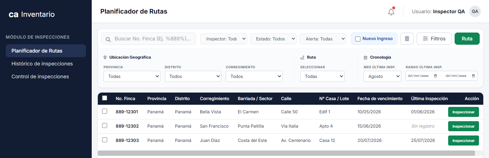

<!-- Página 4 -->

- En el campo de fecha Programada se debe restringir que el usuario pueda seleccionar los días miércoles y viernes.
- Si al intentar guardar la programación de la inspección algún campo es dejado en blanco o null el sistema impedirá guardarlo dejando una advertencia de “Por favor ingrese los valores de los datos obligatorios.
- Cuando hace clic en "Guardar Inspección" entonces el sistema debe guardar los datos, y el modal debe cerrarse automáticamente.
- Solo se podrán reprogramar rutas de inspecciones que no se han sido finalizadas.
- Cuando el usuario hace clic en el botón "Cancelar", en la "X" superior, o hace clic fuera de la ventana de la ventana emergente, la ventana emergente debe cerrarse y no se debe guardar ningún cambio realizado en los campos del formulario.
- Para los usuarios de consulta estas opciones van a estar ocultas.

## HU. 3 generación de inspecciones individual
**Como:** Usuario.
**Quiero:** Poder programar y reprogramar una inspección dentro de la sección Gestionar inspección.
**Para que:** Asignar una inspección a un inspector y llevar el control de las fechas de programación de inspección de cada finca.

### Criterios de Aceptación

- Este módulo hará parte del Web.

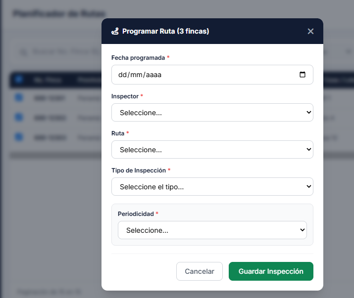

<!-- Página 5 -->

- Al momento de dar clic en el botón verde "Inspeccionar" se debe abrir una ventana emergente con el título "Programar Inspección", en donde el usuario debe diligenciar la información correspondiente a: Fecha de programada (calendario), nombre del inspector (lista desplegable usuarios inspectores), ruta (lista desplegable de las rutas precargadas), tipo de inspección (lista desplegable con los siguientes atributos: Inspección de rutina, Inspección de Nuevo ingreso, Inspección por recibido conforme y Otras inspección; periodicidad (lista desplegable con los siguientes atributos: diaria, semanal, quincenal, mensual, bimensual, trimestral, semestral, anual).
- En el campo de fecha Programada se debe restringir que el usuario pueda seleccionar los días miércoles y viernes.
- Cuando hace clic en "Guardar Inspección" entonces el sistema debe guardar los datos, y el modal debe cerrarse automáticamente con esto el botón original de esa fila en la tabla debe cambiar su texto de "Inspeccionar" a "Reprogramar Inspección" y el color de dicho botón debe cambiar a naranja para reflejar visualmente su nuevo estado.
- Dado que una fila ya tiene una inspección programada y su botón muestra "Reprogramar Inspección", cuando el usuario hace clic en dicho botón entonces se debe abrir la ventana emergente con el título "Reprogramar Inspección" y todos los campos del formulario deben estar precargados con los datos que se guardaron la última vez.
- Solo se podrán reprogramar las inspecciones que aún no han sido finalizado, si la inspecciones se encuentra finalizada, en el la sección de “Gestionar inspecciones” volverá el botón verde de “Inspeccionar”.
- Cuando el usuario hace clic en el botón "Cancelar", en la "X" superior, o hace clic fuera de la ventana de la ventana emergente, la ventana emergente debe cerrarse y no se debe guardar ningún cambio realizado en los campos del formulario.
- Para los usuarios de consulta estas opciones van a estar ocultas.

<!-- Página 6 -->

## HU. 4. Histórico de inspecciones

**Como:** Usuario.
**Quiero:** Poder tener un espacio de bitácora del historial de inspecciones.
**Para que:** Poder consultar la información levantada en campo por los inspectores de manera digital y poder generar los reportes en .pdf.

### Criterios de Aceptación

- Este módulo hará parte del Web.
- El módulo de inspecciones debe estar dentro del menú lateral izquierdo denominado “Módulo de Inspecciones" este debe contener una sección denominada “Histórico de inspecciones”.
- En la grilla de la sección de “Histórico de inspecciones” tendrá los siguientes criterios de búsqueda:

  - Identificador de la finca. Campo texto y tendrá comportamiento de patrones específicos (like).
  - Inspector. Lista desplegable con los nombres de los usuarios asignados a un rol de Inspector.
  - Provincia. Lista desplegable con el nombre de las provincias pre cargadas.
  - Distrito. Lista desplegable con el nombre de los distritos pre cargados.
  - Corregimiento. Lista desplegable con el nombre de los corregimientos pre cargados.
  - Cronología. Rango de Fechas.

- En caso de que el criterio de búsqueda aplique traerá la siguiente información.

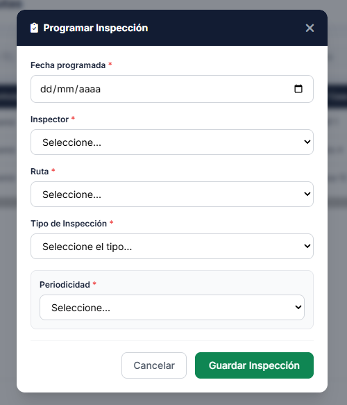

<!-- Página 7 -->

  - Filtro identificador de la finca. En la grilla se cargarán las fincas que se identifiquen con el comportamiento de patrón específico.
  - Filtro inspector. En la grilla se cargarán las fincas que tengan en la última inspección realizada el inspector señalado en el criterio de búsqueda.
  - Filtro Provincia: En la grilla se cargarán las fincas que se encuentren ubicadas en la provincia señalada en el criterio de búsqueda.
  - Filtro Distrito: En la grilla se cargarán las fincas que se encuentren ubicadas en el distrito señalado en el criterio de búsqueda.
  - Filtro Corregimiento: En la grilla se cargarán las fincas que se encuentren ubicadas en el corregimiento señalado en el criterio de búsqueda.
  - Filtro Cronología. En la grilla se cargarán las fincas cuya última inspección se haya realizado en el rango de fechas señalado.

- En caso de que el criterio de búsqueda no aplique el sistema emitirá el mensaje “Criterio de búsqueda no encontrado”.
- En la sección “Histórico de inspecciones” se permitirá la realización de los siguientes filtros combinados:

  - Identificación finca – Inspector –Provincia – Distrito – Corregimiento – Cronología. De acuerdo a la elección del usuario.

- En la sección “Histórico de inspecciones” debe tener un icono de caneca de basura en la cual permita deshacer los filtros seleccionados.
- En la sección “Histórico de inspecciones” contará con paginación y agrupación de 15 inspecciones.
- En la sección “Histórico de inspecciones “debe tener un botón de siguiente, anterior, inicio, final con la finalidad de realizar mejor la navegación si se desconoce el número de finca.
- En la sección “Histórico de inspecciones “debe estar organizada por número de inspección.
- La grilla traerá los siguientes datos por cada registro: Número de finca, Número de inspección, Inspector, Fecha Programada de inspección, Fecha de inspección realizada, Estado de la inspección.
- La grilla traerá los datos de las inspecciones con estado finalizado.
- En cada uno de los registros aparecerán un icono de lápiz (edición), el usuario a dar clic en esta opción aparecerá una ventana emergente donde traerá las fotografías tomadas en cada uno de las inspecciones, al pie de cada foto, habrá un check box, en el cual se señalarán las fotografías que aparecerán dentro del geovisor, Debe tener un botón de confirmar y un mensaje emergente indicando si el usuario se encuentra seguro de visualizar estas imágenes dentro del Geovisor. De igual manera aparecerá un check box para escoger la foto principal, esta acción solo puede aplicar a una de las fotografías, sin embargo, se puede cambiar de acuerdo a la selección del usuario.
- En cada uno de los registros aparecerán un icono de ojo (visualización), el usuario a dar clic en esta opción aparecerá una ventana emergente centrada en la pantalla, trayendo los datos recolectados por la app móvil, los campos serán: Identificación de la inspección, fecha de la inspección, nombre de la inspección, tipo de inspección, estado de ocupación, si esta ocupado o invadido mostrar los datos de identificación del ocupante, y los datos recolectados en secciones: Condición del bien, Puertas, Tipos de Ventanas. Servicios públicos, Distribución del inmueble, Servicios requeridos con las siguientes subsecciones: Limpieza, Cerrajería, Reparación e Inspección Técnica. Firma de inspector, fotografías y observaciones.

<!-- Página 8 -->

- En cada uno de los registros aparecerán un icono de descarga, el usuario a dar clic en esta opción aparecerá en pantalla un visualizador en pdf, donde el usuario podrá visualizar, descargar o imprimir el documento denominado “Resultado de inspección”, en dicho PDF aparcera los datos recolectados por la app móvil, los campos serán: Identificación de la inspección, fecha de la inspección, nombre de la inspección, tipo de inspección, estado de ocupación, si está ocupado o invadido mostrar los datos de identificación del ocupante, y los datos recolectados en secciones: Condición del bien, Puertas, Tipos de Ventanas. Servicios públicos, Distribución del inmueble, Servicios requeridos con las siguientes subsecciones: Limpieza, Cerrajería, Reparación e Inspección Técnica, fotografías y observaciones. Este reporte en .pdf se generará n veces cuando el usuario de clic en la opción, en ningún momento se anexará a un repositorio de documentos. El formato debe ser acorde al formato de calidad aprobado por el cliente en su auditoría interna.

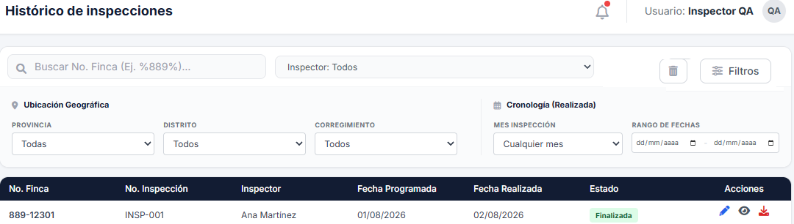

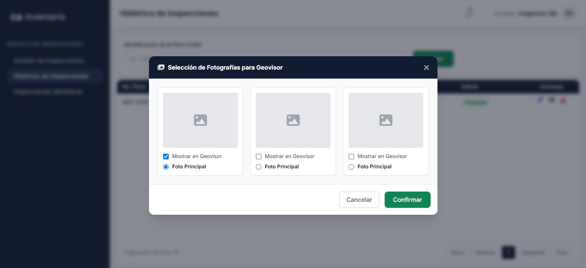

<!-- Página 9 -->

## HU. 5. Control de inspección

**Como:** Usuario.
**Quiero:** Poder visualizar un módulo con el estado actualizado de las inspecciones de todas las fincas del inventario.
**Para que:** Poder administrar, hacer seguimiento y verificar fácilmente si cada finca ya cuenta con una inspección programada.

### Criterios de Aceptación

- Este módulo hará parte del Web.
- El módulo de inspecciones debe estar dentro del menú lateral izquierdo denominado “Módulo de Inspecciones" este debe contener una sección denominada “Control de inspecciones”

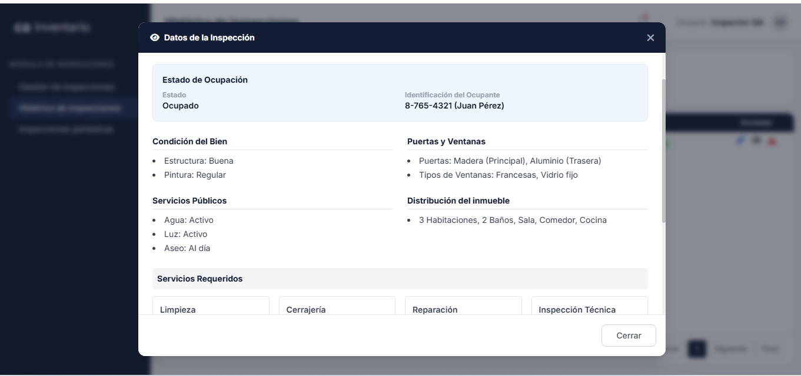

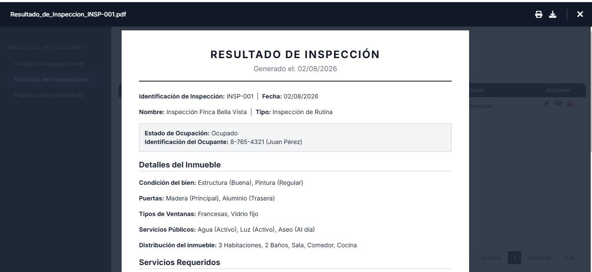

<!-- Página 10 -->

- En la sección “Control de inspecciones” se cargarán todas las fincas que se encuentren en inventario con un estado diferente a vendido.
- En la sección “Control de inspecciones” debe tener un botón de siguiente, anterior, inicio, final con la finalidad de realizar mejor la navegación si se desconoce el número de finca.
- En la sección “Control de inspecciones” debe estar organizada por fecha de inspección cerca a la fecha actual, esto quiere decir, que aparecerán en primer orden las inspecciones que están vencidas, pronto a vencerse, en término y nuevos ingresos.
- En la sección “Control de inspecciones” debe contener los siguientes criterios de búsqueda:

  - Identificador de la finca. Campo texto y tendrá comportamiento de patrones específicos (like).
  - Estado del bien. Lista desplegable con los siguientes dominios: En venta, por publicar, con impedimento de venta, con propuesta, en trámite de traspaso.
  - Estado de Alerta. Lista desplegable con los siguientes dominios: Vencida, próxima a vencer y en término.
  - Provincia. Lista desplegable con el nombre de las provincias pre cargadas.
  - Distrito. Lista desplegable con el nombre de los distritos pre cargados.
  - Corregimiento. Lista desplegable con el nombre de los corregimientos pre cargados.
  - Cronología. Rango de Fechas.

- En caso de que el criterio de búsqueda aplique traerá la siguiente información.

  - Filtro identificador de la finca. En la grilla se cargarán las fincas que se identifiquen con el comportamiento de patrón específico.
  - Filtro Estado del bien. En la grilla se cagarán las fincas que tengan en inventario e estado del bien señalado en el criterio de búsqueda.
  - Filtro Estado de Alerta. En la grilla se cargarán las fincas que tengan como estado de alerta señalado en el criterio de búsqueda.

Vencida: Cuando la fecha actual es posterior a la fecha de vencimiento de la próxima inspección del bien. Próximo a vencer: Cuando la fecha actual se encuentra dentro de los diez (10) días calendario previos a la fecha límite de la próxima inspección. En término: Cuando la fecha actual se encuentra antes de los diez (10) días calendario previos a la fecha límite de la próxima inspección.

  - Filtro Provincia: En la grilla se cargarán las fincas que se encuentren ubicadas en la provincia señalada en el criterio de búsqueda.
  - Filtro Distrito: En la grilla se cargarán las fincas que se encuentren ubicadas en el distrito señalado en el criterio de búsqueda.
  - Filtro Corregimiento: En la grilla se cargarán las fincas que se encuentren ubicadas en el corregimiento señalado en el criterio de búsqueda.
  - Filtro Cronología. En la grilla se cargarán las fincas cuya fecha de vencimiento se encuentre en el rango de fechas señalado.

- En caso de que el criterio de búsqueda no aplique el sistema emitirá el mensaje “Criterio de búsqueda no encontrado”.

<!-- Página 11 -->

- En la sección “Control de inspecciones” se permitirá la realización de los siguientes filtros combinados:

  - Identificación finca – Inspector – Estado de bien – Estado de alerta – Provincia – Distrito – Corregimiento – Cronología. De acuerdo a la elección del usuario.

- La grilla traerá los siguientes datos por cada registro: Número de finca, Provincia, Distrito, Corregimiento, Barriada / Sector, Calle, No. Casa / Lote, Fecha de Vencimiento, Última inspección, Programación Inspección, Estado de alerta de la inspección. Los estados de alerta de la inspección serán:

  - Vencido: Cuando la fecha actual es posterior a la fecha de vencimiento de la próxima inspección del bien.
  - Próximo a vencer: Cuando la fecha actual se encuentra dentro de los diez (10) días calendario previos a la fecha límite de la próxima inspección.
  - En término: Cuando la fecha actual se encuentra antes de los diez (10) días calendario previos a la fecha límite de la próxima inspección.
- El sistema debe garantizar que la fecha de vencimiento calculada recaiga exclusivamente en un día hábil (excluyendo miércoles y viernes). Si el cálculo original coincide con un fin de semana, día festivo, miércoles o viernes, el sistema trasladará automáticamente la fecha de vencimiento al siguiente día hábil permitido.
- El sistema debe emitir una notificación interna cuando la inspección se encuentre en Estado Próxima a vencer, esta debe generarse automáticamente a las 8:00 am de lunes a sábado y debe llegar al inspector asignado, el mensaje que debe mostrar es “La finca No. X se encuentra próxima a inspeccionar, fecha de vencimiento xx xx xxxx)
- Esta alerta debe ser limpiadas todos los días, por lo cual, el mensaje estará vigente 24 horas.

## HU. 5. Integración módulo de inspecciones con módulo de integración y
consulta.

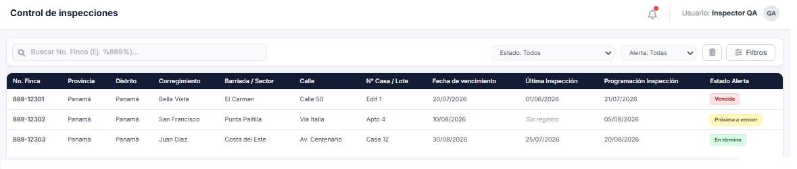

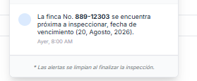

<!-- Página 12 -->

**Como:** Usuario.
**Quiero:** Poder cargar la información del histórico de inspecciones en el módulo de integración y consulta.
**Para que:** Los usuarios definidos en la HU.4 Módulo de integración y consulta tengan a la mano la información del histórico de las inspecciones.

### Criterios de Aceptación

- La grilla de la sección de “Histórico de inspecciones” tendrá el comportamiento de acuerdo al valor ingresado en el único criterio de búsqueda.
- En la sección “Histórico de inspecciones” contará con paginación y agrupación de 15 inspecciones.
- En la sección “Histórico de inspecciones “debe tener un botón de siguiente, anterior, inicio, final con la finalidad de realizar mejor la navegación si se desconoce el número de finca.
- En la sección “Histórico de inspecciones “debe estar organizada por número de inspección.
- La grilla traerá los siguientes datos por cada registro: Número de finca, Número de inspección, Inspector, Fecha Programada de inspección, Fecha de inspección realizada, Estado de la inspección.
- La grilla traerá los datos de las inspecciones con estado finalizado.
- En cada uno de los registros aparecerán un icono de ojo (visualización), el usuario a dar clic en esta opción aparecerá una ventana emergente centrada en la pantalla, trayendo los datos recolectados por la app móvil, los campos serán: Identificación de la inspección, fecha de la inspección, nombre de la inspección, tipo de inspección, estado de ocupación, si está ocupado o invadido mostrar los datos de identificación del ocupante, y los datos recolectados en secciones: Condición del bien, Puertas, Tipos de Ventanas. Servicios públicos, Distribución del inmueble, Servicios requeridos con las siguientes subsecciones: Limpieza, Cerrajería, Reparación e Inspección Técnica. Firma de inspector, botón de importación de fotografías y observaciones.
- En cada uno de los registros aparecerán un icono de descarga, el usuario a dar clic en esta opción aparecerá en pantalla un visualizador en pdf, donde el usuario podrá visualizar, descargar o imprimir el documento denominado “Resultado de inspección”, en dicho PDF aparcera los datos recolectados por la app móvil, los campos serán: Identificación de la inspección, fecha de la inspección, nombre de la inspección, tipo de inspección, estado de ocupación, si está ocupado o invadido mostrar los datos de identificación del ocupante, y los datos recolectados en secciones: Condición del bien, Puertas, Tipos de Ventanas. Servicios públicos, Distribución del inmueble, Servicios requeridos con las siguientes subsecciones: Limpieza, Cerrajería, Reparación e Inspección Técnica. Fotografías y observaciones. Este reporte en .pdf se generará n veces cuando el usuario de clic en la opción, en ningún momento se anexará a un repositorio de documentos. El reporte .pdf tendrá la estructura del documento aprobado por calidad del cliente.

<!-- Página 13 -->

## HU. 6. APP móvil
**Como:** Usuario.
**Quiero:** Que el sistema tenga una aplicación móvil.
**Para que:** Puede realizar el registro de información en campo una vez generada la inspección.

### Criterios de Aceptación

- La app móvil tendrá una opción de cerrar sesión.
- La app móvil tendrá un encabezado que permita distinguir donde el usuario se encuentra dependiendo de los módulos que la integran.
- La app móvil dentro del encabezado tendrá una flecha hacia la izquierda que al dar clic por el usuario retornará a la sección anterior del módulo que se encuentre el usuario.
- La app móvil será descargada e instalada mediante archivo. Apk.
- La app móvil estará disponible para Android versión 11 o superior.
- La app móvil tendrá cuatro módulos denominados inspecciones programadas, inspecciones finalizadas, rutas de recorrido y sincronización.
- La app móvil de acuerdo al selector marcará el módulo de un color azul más claro con la finalidad de indicarle visualmente al usuario donde va a ingresar.
- La app móvil tendrá una autenticación el módulo de inspecciones finalizadas y sincronización para el manejo offline.

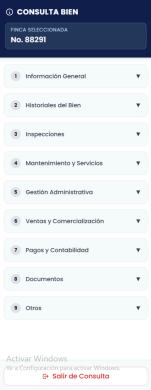

<!-- Página 14 -->

## HU. 7. Módulo de inspecciones programadas
**Como:** Usuario.
**Quiero:** Que la app móvil cargue las inspecciones programadas a cada uno de los inspectores.
**Para que:** Poder tener un registro y control de las inspecciones que tiene asignadas.

### Criterios de Aceptación

- Si el usuario selecciona el módulo de inspecciones programadas se cargarán todas las inspecciones que se encuentren sincronizadas con asignación al inspector que se ha autenticado según asignación desde el módulo de “Planificador de rutas” (teniendo en cuenta las inspecciones programadas y reprogramadas). Se debe tener en cuenta que el usuario debe realizar primero la acción de sincronizar para poder tener al día la información en la app móvil.
- En la parte superior del módulo de inspecciones programadas aparecerá una leyenda con un azul oscuro indicando que la inspección se encuentra en estado Activa y un azul claro cuando la inspección se encuentre en proceso.

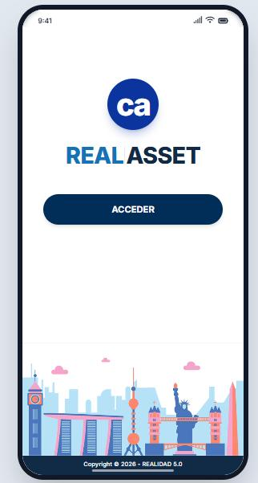

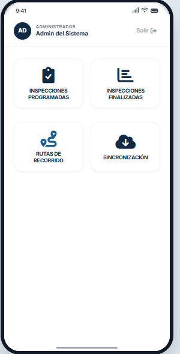

<!-- Página 15 -->

- En el módulo de inspecciones programadas se cargarán de acuerdo a orden cronológico de las más próximas a las futuras inspecciones que tiene asignadas cada uno de los inspectores autenticados.
- Cada una de las inspecciones será una tarjeta principal, al lado izquierdo se indicará el color de acuerdo al estado de la inspección, este puede ser azul oscuro (Activa) o azul claro (En proceso).
- Cada una de las tarjetas que representan una inspección tendrá ordenados los siguientes campos: Id de finca, Tipo de Bien, Estado de bien, Fecha programada, Tipo de inspección Corregimiento, Barriada / Sector, Calle, No. Casa / Lote.
- En la parte inferior derecha de cada una de las tarjetas que representan una inspección estará un icono de edición (lápiz) que llevará al usuario para el diligenciamiento de la información de campo, el usuario al señalar dicho formulario en la app móvil se cargará la información de la última inspección en estado finalizado sin las imágenes tomadas en dicha inspección.
- Una vez que la inspección haya finalizado la tarjeta se ocultará dentro del módulo de inspecciones programadas.
- Las tarjetas serán contenerizadas de acuerdo a la fecha de programación, esto quiere decir que dentro del módulo de inspecciones programadas cada contenedor tendrá un título que se ubicará al lado izquierdo de la app con la fecha de programación agrupando las inspecciones por día.
- El módulo de inspecciones programadas debe contener un único criterio de búsqueda que será la identificación de la finca, este tendrá comportamiento de patrones específicos (like).
- El módulo de inspecciones programadas tendrá gestos de desplazamiento para la interacción entre las n inspecciones programadas.

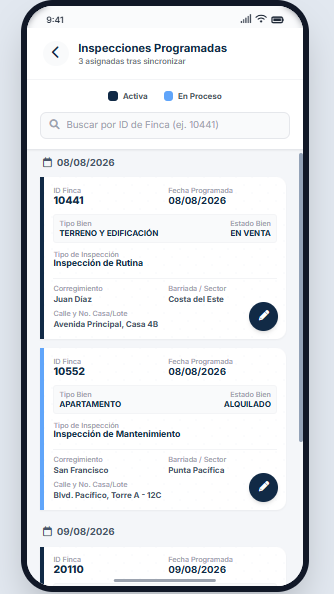

<!-- Página 16 -->

## HU. 8. Formulario de levantamiento
**Como:** Usuario.
**Quiero:** Que cada una de las inspecciones tengan un único levamiento de campo información.
**Para que:** Poder tener la trazabilidad de cada una de las inspecciones y sus cambios en el tiempo.

### Criterios de Aceptación

- El formulario de levantamiento se activará una vez el usuario de clic en el botón de edición (lápiz) que se encuentra en los módulos de Inspecciones programadas e Inspecciones No programadas.
- El formulario de levantamiento traerá a edición los datos diligenciados en la última inspección realizada a la finca con estado finalizado. (Precargue de información sin las imágenes).
- El formulario de levantamiento tendrá un encabezado en donde se distingue la identificación de la inspección y la identificación de la finca de la inspección que se esta diligenciando.
- El formulario de levantamiento estará estructurado de la siguiente manera:

  - Sección Ubicación (Obligatoria)

    - Campo Ubicación: el usuario visualiza casilla Text Field (Campo de texto), en donde se precargan las coordenadas geográficas que será traídos del Módulo de inventario de la finca a inspeccionar, al lado derecho de la casilla Text Field (Campo de texto) deberá aparecer un botón de Location Picker (Selector de ubicación), el cual desplegará un mapa como ventana emergente en el centro de la app móvil en el cual traerá un basemap de calles y con ello las siguientes herramientas:

- Herramienta Zoom: debe mostrar en una ubicación fija y accesible dos botones claramente identificables: uno con un símbolo de más (+) para acercar, y otro con un símbolo de menos (-) para alejar. La escala del mapa debe aumentar o disminuir un nivel de zoom respectivo por cada interacción, centrándose en el punto medio de la pantalla actual. Debe contener un botón de retorno al zoom principal donde se ubique la coordenada inicial de la finca a inspeccionar. Debe tener zoom de desplazamiento.
- Herramienta de ubicación en tiempo real: Debe desplegar una alerta solicitando permiso explícito para acceder a la ubicación del dispositivo. Debe centrarse automáticamente en esas coordenadas y realizar un acercamiento (zoom in) a una escala detallada que permita ver el entorno inmediato. La ubicación se mostrará con un marcador distintivo en color azul rey. Debe alterar la vista del mapa y debe mostrar una notificación clara indicando: "No fue posible acceder a su ubicación. Verifique los permisos o la señal de su dispositivo.

    - Con ayuda del Location Picker (Selector de ubicación) el inspector podrá cambiar la ubicación de la finca, en el momento de la sincronización de la inspección finalizada,

<!-- Página 17 -->

la nueva coordenada seleccionada aplicará dentro del módulo de inventario, garantizando la correcta información geográfica.

o   Sección Estado del bien (Obligatoria)

    - Campo Condición del Bien, el usuario visualizará una lista desplegable donde podrá seleccionar una opción con los siguientes atributos: Buena, Regular, Vandalizada.
    - Campo Estado de Ocupación, el usuario visualizará una lista desplegable donde podrá seleccionar una opción con los siguientes atributos: Desocupado, Ocupado, Invadido. Si el usuario selecciona los Estados de Ocupado o de Invadido, aparecerá una nueva sección denominado Datos de Ocupante con los siguientes campos: Nombre del ocupante ( se debe realizar validaciones que se ingresen datos alfabéticos), Tipo de identificación (lista desplegable con los atributos (Cédula de identidad, Pasaporte), Número de contacto ( se debe realizar validaciones que se ingresen datos numéricos) y Comentarios ( se restringe el campo a 500 caracteres, en caso de excederlos debe aparecer en una ventana emergente el mensaje indicando que se ha excedido la cantidad de caracteres (500)).

o   Sección Puertas. (Obligatoria)
    - Campo de Entrada de Principal: se debe mostrar casillas de verificación (checkboxes) con las siguientes opciones: Hierro, Multilock, Madera, Vidrio/Aluminio. El usuario debe poder seleccionar múltiples opciones. Cuando el usuario marque una casilla de verificación. Se debe habilitar un campo numérico que estará ubicado al lado derecho del checkbox para el ingreso de una cantidad entera. El campo numérico debe permitir incrementar o reducir el valor usando flechas de control (spinner).
    - Campo de Traseras se debe mostrar casillas de verificación (checkboxes) con las siguientes opciones: Hierro, Multilock, Madera, Vidrio/Aluminio. El usuario debe poder seleccionar múltiples opciones. Cuando el usuario marque una casilla de verificación. Se debe habilitar un campo numérico que estará ubicado al lado derecho del checkbox para el ingreso de una cantidad entera. El campo numérico debe permitir incrementar o reducir el valor usando flechas de control (spinner).

o   Sección Tipos de Ventanas. (Obligatoria)

- Campo de Tipos de Ventana: se debe mostrar casillas de verificación (checkboxes) con las siguientes opciones: Vidrios flojos, ornamentales, verjas, persianas, francesa, otros (se habilita una casilla alfabética para que el usuario escriba la categorización). El usuario debe poder seleccionar múltiples opciones. Cuando el usuario marque una casilla de verificación. Se debe habilitar un campo numérico que estará ubicado al lado derecho del checkbox para el ingreso de una cantidad entera. El campo numérico debe permitir incrementar o reducir el valor usando flechas de control (spinner).

o   Sección Servicios públicos.

<!-- Página 18 -->

    - Campo de Servicios públicos: se debe mostrar casillas de verificación (checkboxes) con las siguientes opciones: Luz eléctrica conectada, con suministro de agua (medidor), con suministro de agua (niple), servicio de agua desconectad. El usuario debe poder seleccionar múltiples opciones.

o   Sección Distribución del inmueble. (Obligatoria)

- Campo de Distribución del inmueble: se debe mostrar casillas de verificación (checkboxes) con las siguientes opciones: Sala, recamara, comedor, cocina, baños, deposito, portal, terraza, lavandería, piscina. El usuario debe poder seleccionar múltiples opciones. Cuando el usuario marque una casilla de verificación. Se debe habilitar un campo numérico que estará ubicado al lado derecho del checkbox para el ingreso de una cantidad entera. El campo numérico debe permitir incrementar o reducir el valor usando flechas de control (spinner).

o   Sección Servicios requeridos.

    - Campo de Limpieza: se debe mostrar casillas de verificación (checkboxes) con las siguientes opciones: Interna, externa, retiro de enseres, limpieza de piscina. El usuario debe poder seleccionar múltiples opciones.
    - Campo de Cerrajería: se debe mostrar casillas de verificación (checkboxes) con las siguientes opciones: Hierro, Multilock, Madera, Vidrio/Aluminio. El usuario debe poder seleccionar múltiples opciones. Cuando el usuario marque una casilla de verificación. Se debe habilitar un campo numérico que estará ubicado al lado derecho del checkbox para el ingreso de una cantidad entera. El campo numérico debe permitir incrementar o reducir el valor usando flechas de control (spinner).
    - Campo de Reparación: se debe mostrar casillas de verificación (checkboxes) con las siguientes opciones: Filtraciones/Impermeabilización, Trabajos eléctricos, Trabajos de Plomería, Reemplazo o Reparación de Puertas, Reemplazo o Reparación de Ventanas, Trabajos de Cercado, Reparación de Techos, Reparación de Paredes, Otras Reparaciones (se habilita una casilla alfabética para que el usuario escriba la categorización). El usuario debe poder seleccionar múltiples opciones.

o   Sección Inspección técnica.

- Campo Inspección Técnica de ingeniería: se debe mostrar una casilla de verificación (checkbox) con la opción de Inspección Técnica Requerida.
- Campo Inspección de Mantenimiento: se debe mostrar casillas de verificación (checkboxes) con las siguientes opciones: Inspección eléctrica, inspección de plomería, inspección Aire Acondicionado. El usuario debe poder seleccionar múltiples opciones.
- Campo Motivación: Campo de texto alfanumérico con un límite máximo de 2.000 caracteres, destinado a registrar la justificación o motivo de la inspección. Debe integrar una funcionalidad de dictado por voz (Speech-to-Text) que transcriba automáticamente el audio del usuario dentro de la casilla.

<!-- Página 19 -->

  - Sección Fotografías. (Obligatoria)

- La interfaz debe mostrar una sección con el título "Fotografías" acompañado de un icono de cámara, y el subtítulo "REGISTRO FOTOGRÁFICO EN CAMPO. El área de acción debe ser un contenedor bien definido (con borde discontinuo) que incluya el icono de carga (nube) y el texto "Subir o Tomar Fotos". Al tocar el botón "Subir o Tomar Fotos", el sistema operativo del dispositivo móvil (Android/iOS) debe abrir su menú de selección estándar para que el usuario elija entre:

  - Tomar Foto (Cámara).
  - Subir desde Galería/Fotos.

Si se selecciona la cámara, esta debe abrirse dentro de la app o a nivel de sistema. Una vez tomada y confirmada la foto, esta debe cargarse automáticamente en la sección del formulario.

Si se selecciona la galería, el usuario debe poder navegar y seleccionar imágenes.

El sistema debe permitir la selección múltiple de imágenes desde la galería de una sola vez (ej. mantener presionada una imagen y luego tocar otras).

Una vez seleccionadas o tomadas, las imágenes deben aparecer como previsualizaciones dentro de la sección de "Fotografías". Cada imagen previsualizada debe tener un icono (ej. una "X" en la esquina) que permita al usuario eliminar una foto individual si se equivocó, antes de enviar el formulario.

La app móvil debe poder procesar y cargar varias imágenes simultáneamente de forma eficiente. Las imágenes cargadas deben almacenarse y vincularse correctamente al registro de levantamiento actual.

  - Sección Observaciones.

- Campo "Observación": Campo de texto alfanumérico con un límite máximo de 2.000 caracteres, destinado a registrar observaciones de la inspección. Debe integrar una funcionalidad de dictado por voz (Speech-to-Text) que transcriba automáticamente el audio del usuario dentro de la casilla.

- En la parte final del formulario de levantamiento aparecerán los siguientes botones:

  - Botón Guardar: Permitir guardar un formulario provisional. Al momento de dar clic en este botón la inspección pasará al estado En Proceso, si el usuario ingresa nuevamente cargará la información previamente diligenciada. Se debe tener en cuenta que no manejará un histórico de cambios, solamente traerá los últimos datos diligenciados hasta que se da en el botón de finalizar.
  - Botón Finalizar: Permitir culminar el proceso de levantamiento de información. Al momento de dar clic en este botón aparecerá una ventana emergente indicando “Esta seguro que desea finalizar la inspección” con sus botones de afirmación o negación. Si el botón es

<!-- Página 20 -->

afirmativo la inspección pasa a un estado Finalizado, desaparece del módulo de inspecciones programadas inspecciones no programadas y se registra la firma de la inspección. Para la firma de los inspectores se debe mostrar una ventana emergente, donde se solicite el cargue de una imagen que previamente se encuentre en el dispositivo móvil, esta será la firma de los inspectores.
- Si al intentar finalizar el formulario de levantamiento inspección algún campo es dejado en blanco o null el sistema impedirá guardarlo dejando una advertencia de “Por favor ingrese los valores de los datos obligatorios”.

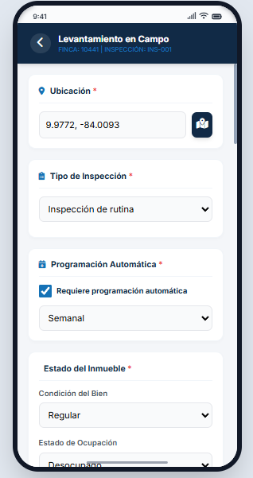

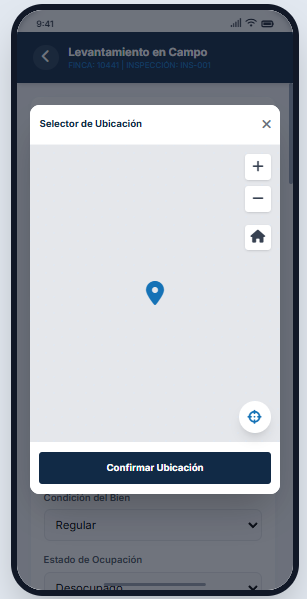

<!-- Página 21 -->

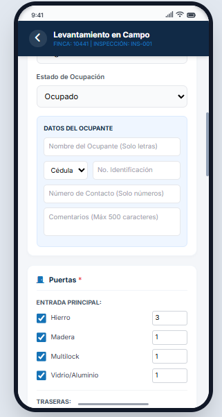

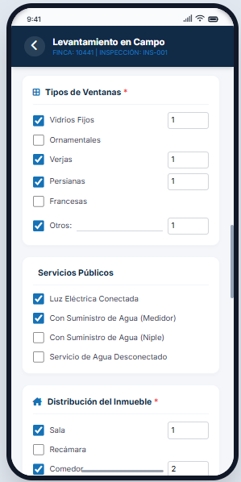

<!-- Página 22 -->

## HU. 10. Módulo de Inspecciones Finalizadas
**Como:** Usuario.
**Quiero:** Que exista un espacio dentro de la app móvil en el cual se carguen las inspecciones que se han finalizado.
**Para que:** Poder tener un control desde la app móvil por parte del inspector de las inspecciones que se encuentran sincronizadas para ser consultadas dentro del aplicativo web.

### Criterios de Aceptación

- Este módulo funcionará solamente con conexión a internet, para ello el usuario debe autenticarse con la finalidad de ver el histórico de inspecciones en tiempo real de la información levantada en campo.
- En la parte superior derecha existirá un botón en forma de nube en el cuál se realice la sincronización de la información de salida de la app móvil.
- La aplicación debe mostrar un indicador visual de carga (barra de progreso). Al finalizar con éxito, debe mostrar el mensaje: "Información sincronizada correctamente” en caso de que el proceso sea interrumpido se debe mostrar el mensaje “Información no sincronizada intente nuevamente”.

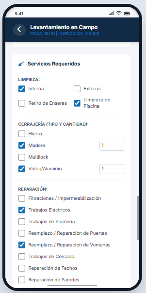

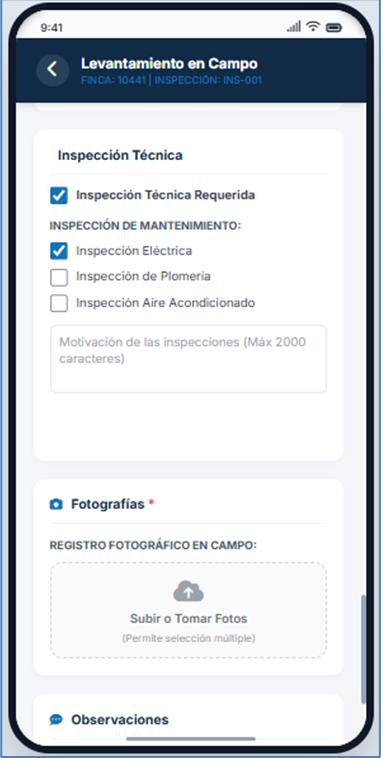

<!-- Página 23 -->

- Si el usuario selecciona el módulo de inspecciones finalizadas se cargarán todas las inspecciones que cuenten con un formulario de levantamiento finalizado que se haya realizado el inspector que se ha autenticado.
- En la parte superior del módulo de inspecciones finalizadas aparecerá una leyenda en color gris claro (inspecciones no sincronizadas) y color azul oscuro (inspecciones sincronizadas).
- En el módulo de inspecciones finalizadas se cargarán de acuerdo a orden cronológico de las más recientes a las más antiguas finalizadas por el inspector que se ha autenticada.
- Cada una de las inspecciones será una tarjeta principal, al lado izquierdo se indicará el color de acuerdo al estado de sincronización, este puede ser gris claro (No sincronizado) o azul oscuro (Sincronizado).
- Cada una de las tarjetas que representan una inspección tendrá ordenados los siguientes campos: Id de finca, Tipo de Bien, Estado de bien, Fecha Finalizada, Tipo de inspección Corregimiento, Barriada / Sector, Calle, No. Casa / Lote.
- Las tarjetas serán contenerizadas de acuerdo a la fecha de finalización, esto quiere decir que dentro del módulo de inspecciones programadas cada contenedor tendrá un título que se ubicará al lado izquierdo de la app con la fecha de finalización agrupando las inspecciones por día.
- El módulo de inspecciones finalizadas contener un único criterio de búsqueda que será la identificación de la finca, este tendrá comportamiento de patrones específicos (like).
- El módulo de inspecciones finalizadas tendrá gestos de desplazamiento para la interacción entre las n inspecciones programadas.
- El módulo de inspecciones finalizadas tendrá un botón de visualización, este se ubicará al lado inferior derecha de la tarjeta de las inspecciones, en el cual al darle clic la app móvil redireccionará al formulario de levantamiento atado el ID de la inspección, el formulario no debe dejar editar y tendrá un botón en la parte inferior de regresar, que al seleccionarlo retornará al módulo de inspecciones finalizadas.

<!-- Página 24 -->

## HU. 11. Módulo de Rutas de inspección
**Como:** Usuario.
**Quiero:** Visualizar en un mapa mis inspecciones asignadas y el estado general de las inspecciones de las fincas, filtradas por día.
**Para que:** Para generar automáticamente la ruta más óptima de visita y reducir mis tiempos de desplazamiento.

### Criterios de Aceptación

- Si el usuario ingresa al módulo de Rutas optimas se debe mostrar un mapa base de calles interactivo (con opciones de zoom y paneo) y un control deslizable en la parte inferior para seleccionar la fecha de programación. Por defecto se cargara la fecha now() dependiendo de la última sincronización realizada mostrando la información correspondiente.
- En el mapa se cargará la geometría punto que representa cada una de las fincas con su relación de la inspección, la simbología va estar de acuerdo a lo siguiente:

- Azul Oscuro: Inspecciones asignadas al usuario activo para la fecha seleccionada.

- Dentro del entorno del mapa debe mostrarse una leyenda que pueda ocultarse o habilitarse, ubicada en la parte inferior derecha, en el cual se especificara la simbología descrita en la presente historia de usuario.

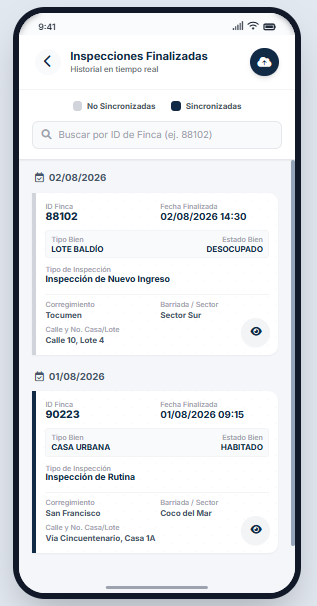

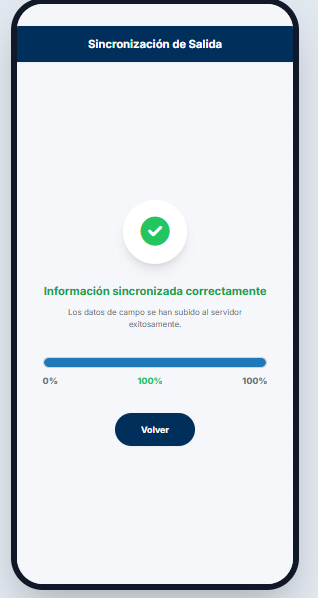

<!-- Página 25 -->

- Cada uno de los puntos va manejar una etiqueta cuando el usuario pasa por encima de la representación, la cual mostrara, la identificación de la finca.
- La app móvil debe calcular y trazar de forma automática el trayecto por las calles. Y la ruta trazada únicamente debe conectar los puntos de color azul oscuro (las inspecciones del usuario para ese día).
- Cuando el usuario desliza el control inferior hacia otra fecha, el mapa debe recargar instantáneamente los puntos (cambiando los azules oscuros según corresponda) y recalcular una nueva ruta óptima para esa nueva fecha de acuerdo a la información sincronizada.

## HU. 12. Módulo de Sincronización
**Como:** Usuario.
**Quiero:** Sincronizar y descargar la información de las inspecciones programadas, inspecciones no programadas, inspecciones programadas periódicas y rutas optimas.
**Para que:** Poder realizar las inspecciones en campo funcionando en modo offline sin depender de una conexión a internet.

### Criterios de Aceptación

- Si el usuario ingresa al módulo de sincronización la app móvil evalúa el estado del dispositivo. Debe mostrar un inicio de autenticación y que el dispositivo cuente con conexión a internet estable. En caso de no existir conexión se debe mostrar un mensaje indicando "No es posible sincronizar. Verifique su conexión a internet"
- El proceso de sincronización debe durar hasta 5 minutos con la finalidad de descargar dentro del app móvil se debe descargar y almacenar de forma local (en la base de datos del móvil) la información actualizada de las siguientes entidades: Tablas de dominio (catálogos, listas desplegables, tipos de fallas, etc.), Inspecciones programadas, Inspecciones no programadas, Inspecciones periódicas programadas y Rutas óptimas asignadas al usuario.

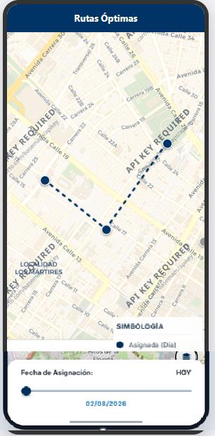

<!-- Página 26 -->

- La aplicación debe mostrar un indicador visual de carga (barra de progreso). Al finalizar con éxito, debe mostrar el mensaje: "Información sincronizada correctamente” en caso de que el proceso sea interrumpido se debe mostrar el mensaje “Información no sincronizada intente nuevamente”.
- Al tener la información sincronizada si el dispositivo móvil pierde la conexión a internet, el usuario debe poder navegar por la aplicación, consultar sus rutas óptimas y ejecutar/diligenciar cualquier tipo de inspección descargada utilizando exclusivamente los datos almacenados localmente.

## HU. 13. Integración módulo de inspecciones con módulo de administración,
mantenimiento y servicios
**Como:** Usuario.
**Quiero:** Que el sistema realiza la generación automática de tareas por servicio requerido, reparaciones e inspecciones especiales al momento de sincronizar las inspecciones finalizadas.
**Para que:** Poder realizar notificaciones automáticas a los usuarios con acceso al módulo de administración, mantenimiento y servicios.

### Criterios de Aceptación

- Al momento de generar la sincronización de inspecciones finalizadas, desde la app móvil se emitirá un correo electrónico y un aviso de notificación a los usuarios con acceso al módulo de administración, mantenimiento y servicios.
- El aviso de notificación debe permanecer en los usuarios hasta cuando se generen las ordenes de servicio.
- Se genera n alertas dependiendo de los servicios e inspecciones técnicas marcados al momento del diligenciamiento del formulario de levantamiento.

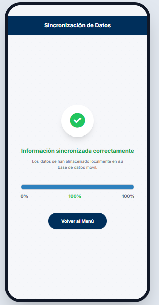

<!-- Página 27 -->

## HU. 14. Integración módulo de inspecciones con módulo de inventario.
**Como:** Usuario.
**Quiero:** Que el sistema realice la actualización de información de acuerdo con la información levantada en campo.
**Para que:** Poder realizar la actualización de información manteniendo la integralidad del dato.

### Criterios de Aceptación

- Al momento de generar la sincronización de inspecciones finalizadas, desde la app móvil se emitirá un correo electrónico y un aviso de notificación a los usuarios de inventario que tiene el control de la finca indicando que se han realizado las siguientes actualizaciones en el registro de inventario de las fincas inspeccionadas. Los campos a actualizar son:

  - Coordenadas geográficas.
  - Estatus de ocupación.
  - Condición del bien.
  - Distribución del bien.

- Al momento de realizar de la actualización de la información de inventario, se debe registrar el cambio en el histórico de bienes inventario para garantizar la trazabilidad del cambio.
