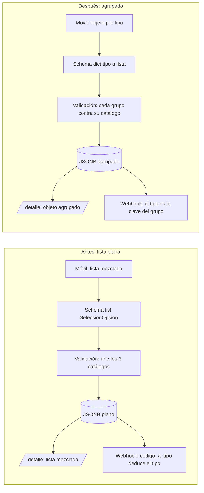
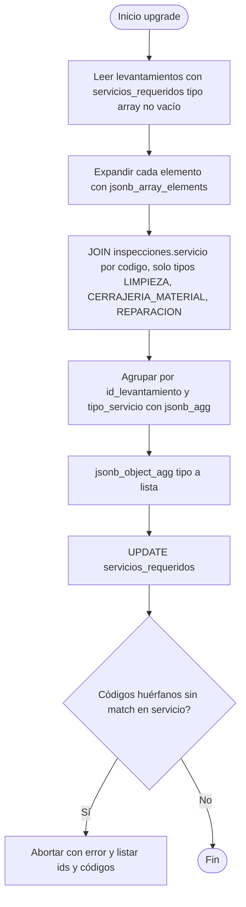
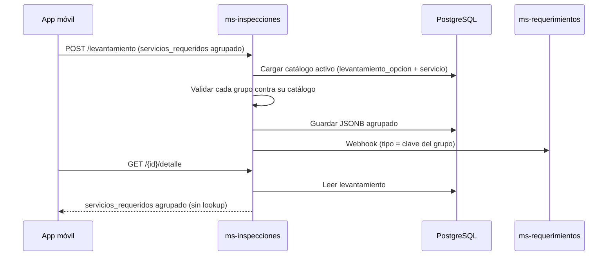

# Plan: `servicios_requeridos` agrupado por tipo de servicio (desde el guardado)

## 1. Objetivo

Hoy `levantamiento_inspeccion.servicios_requeridos` guarda y devuelve una **lista plana** que mezcla
Limpieza, Cerrajería y Reparación. El tipo de servicio no queda guardado; se deduce cada vez
buscando el código en el catálogo (`inspecciones.servicio`).

Se cambia el contrato para que `servicios_requeridos` sea un **objeto agrupado por `tipo_servicio`**,
igual que ya funciona `puertas` (dict por ubicación), de punta a punta: request, validación,
guardado, lectura (`/detalle`), webhook a ms-requerimientos y PDF.

**Antes**

```json
"servicios_requeridos": [
  {"codigo": "INTERNA"},
  {"codigo": "HIERRO", "cantidad": 2},
  {"codigo": "OTRAS_REPARACIONES", "descripcion": "Cambiar cañería"}
]
```

**Después**

```json
"servicios_requeridos": {
  "LIMPIEZA":            [{"codigo": "INTERNA"}],
  "CERRAJERIA_MATERIAL": [{"codigo": "HIERRO", "cantidad": 2}],
  "REPARACION":          [{"codigo": "OTRAS_REPARACIONES", "descripcion": "Cambiar cañería"}]
}
```

Claves permitidas: `LIMPIEZA`, `CERRAJERIA_MATERIAL`, `REPARACION`. Cualquier otra se rechaza.
`INSPECCION_TECNICA` sigue viviendo en `tipos_inspeccion_tecnica` (no cambia).

## 2. Por qué

- El JSONB plano no guarda el tipo; `UNIQUE (tipo_servicio, codigo)` permite que dos tipos compartan
  código y la lista quedaría ambigua (`codigo_a_tipo` en el webhook se quedaría con uno solo).
- El frontend móvil ya muestra tres secciones; recibir la misma forma que envía evita lookups.
- Consistencia con `puertas`.

## 3. Flujo (antes vs. después)



## 4. Cambios por capa

| # | Capa | Archivo | Cambio |
|---|------|---------|--------|
| 1 | Schema request | [inspecciones.py:442](app/presentation/api/schemas/inspecciones.py#L442) | `servicios_requeridos: dict[str, list[SeleccionOpcion]] \| None`. Validar claves ∈ {LIMPIEZA, CERRAJERIA_MATERIAL, REPARACION} y sin códigos duplicados dentro de cada grupo (reusar `_validar_puertas_sin_duplicados`). Sacar el campo del validador de listas. |
| 2 | Schema response | [inspecciones.py:333](app/presentation/api/schemas/inspecciones.py#L333) | `LevantamientoDetail.servicios_requeridos` con el mismo tipo dict. |
| 3 | Validación | [levantamiento_validacion.py:98](app/application/levantamiento_validacion.py#L98) | Reemplazar la unión de catálogos por un bucle: por cada `tipo, selecciones` validar cada selección contra `opciones[tipo]` (`_validar_seleccion(tipo, ...)`). El error ahora indica el grupo real, no `SERVICIOS_REQUERIDOS`. |
| 4 | Guardado | [inspeccion_repository.py:644](app/infrastructure/database/inspeccion_repository.py#L644) | Sin cambio de columna (sigue JSONB); solo cambia la forma del valor. Verificar el serializador `_jsonb`. |
| 5 | Lectura | [inspeccion_service.py:945](app/application/inspeccion_service.py#L945) | `_parse_jsonb` devuelve el dict; con la migración de datos no hace falta lookup. |
| 6 | Webhook | [inspeccion_service.py:1368](app/application/inspeccion_service.py#L1368) | Eliminar `codigo_a_tipo`; iterar `body.servicios_requeridos.items()` y pasar la clave como `tipo_interno` a `_traducir_seleccion`. |
| 7 | PDF | [inspeccion_pdf.py:290](app/presentation/pdf/inspeccion_pdf.py#L290) | Iterar por grupo (mostrar subtítulo Limpieza / Cerrajería / Reparación) en vez de buscar el tipo por código. |
| 8 | Migración de datos | `migrations/versions/2026MMDD_00NN_group_servicios_requeridos.py` | Ver sección 5. |
| 9 | Tests | `tests/application/test_levantamiento_service.py`, `test_inspeccion_service.py`, `tests/presentation/test_inspeccion_pdf.py`, `tests/api/test_pdf_inspeccion.py` | Actualizar fixtures al formato agrupado; agregar casos: clave de grupo inválida, código de un grupo colocado en otro, duplicado dentro de un grupo, grupo vacío. |
| 10 | Docs / Postman | `docs/API_REFERENCE_MS_INSPECCIONES.md`, `docs/BACKEND_MS_INSPECCIONES.md`, `docs/ESQUEMA_BASE_DATOS_ACTUAL.md`, `ms-inspecciones.postman_collection.json` | Nuevo formato de request/response. |

## 5. Migración de datos existentes

Alembic, con `upgrade` y `downgrade` (el `downgrade` aplana de nuevo).



Puntos a cuidar:

- Solo tocar filas donde `jsonb_typeof(servicios_requeridos) = 'array'` (idempotente si se re-ejecuta).
- Un array vacío `[]` pasa a `{}`; `NULL` se queda `NULL`.
- Códigos sin match en `servicio` (catálogo desactivado o borrado): la migración debe **fallar
  explícitamente** y listar los casos, no descartarlos en silencio.
- `downgrade`: recorrer los grupos y concatenar las listas en un array plano.
- Si el catálogo permite el mismo `codigo` en dos tipos, el JOIN duplicaría; hoy no ocurre
  (verificar con una consulta previa antes de migrar en cada ambiente).

## 6. Compatibilidad y despliegue

Es un cambio de contrato **incompatible** con la app móvil actual.

Decisión pendiente (elegir una):

- **A. Corte limpio (recomendado si solo `desa` tiene datos):** backend y app móvil salen juntos;
  el POST solo acepta el formato agrupado.
- **B. Transición:** durante un período el POST acepta ambos formatos (un `model_validator(mode="before")`
  que, si recibe una lista, la agrupa usando el catálogo). Se retira cuando el móvil migre.
  Mayor costo y más superficie de errores; solo si hay clientes móviles en producción.



## 7. Orden de implementación

1. Schema request/response (puntos 1-2) y validación (3), con tests en rojo primero.
2. Webhook (6) y PDF (7).
3. Migración de datos (8) + prueba `upgrade`/`downgrade` en una base local con datos planos.
4. Actualizar tests restantes, docs y Postman (9-10).
5. Correr `ruff`, `mypy` y `pytest`.
6. Coordinar con el desarrollador frontend la fecha de corte (opción A o B).

## 8. Riesgos

| Riesgo | Mitigación |
|--------|------------|
| App móvil vieja envía lista plana y recibe 422 | Coordinar despliegue conjunto o implementar transición (6.B). |
| Datos huérfanos rompen la migración | Consulta previa de códigos sin match; migración que falla con detalle. |
| Webhook a ms-requerimientos cambia sin querer | Test que compare el payload resultante con el actual para las mismas selecciones. |
| PDF pierde el orden de secciones | Iterar en orden fijo LIMPIEZA → CERRAJERIA_MATERIAL → REPARACION. |

## 9. Fuera de alcance

- `tipos_inspeccion_tecnica` / `inspeccion_tecnica_req` (no cambian).
- Cambios en el catálogo `inspecciones.servicio` o en el endpoint `GET /levantamiento/catalogos`.
- Cambios en el contrato con ms-requerimientos (el payload saliente debe quedar idéntico).
